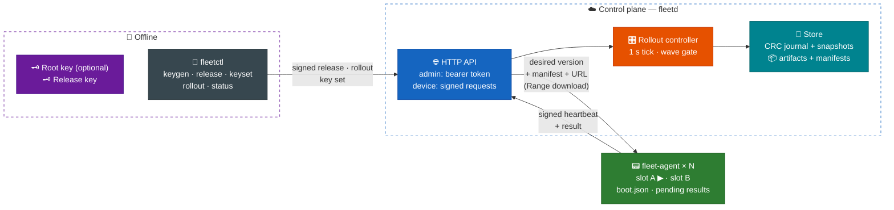
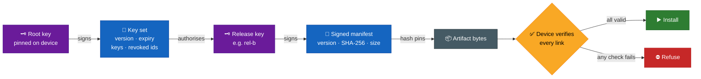
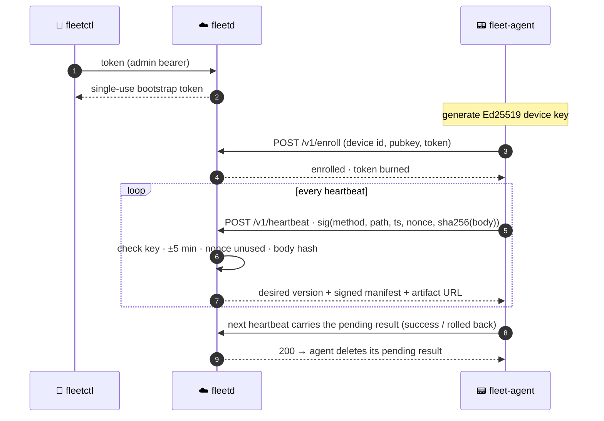
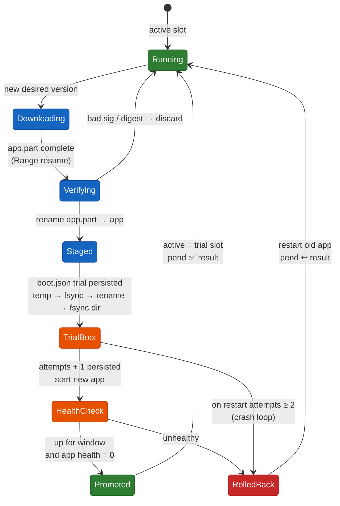
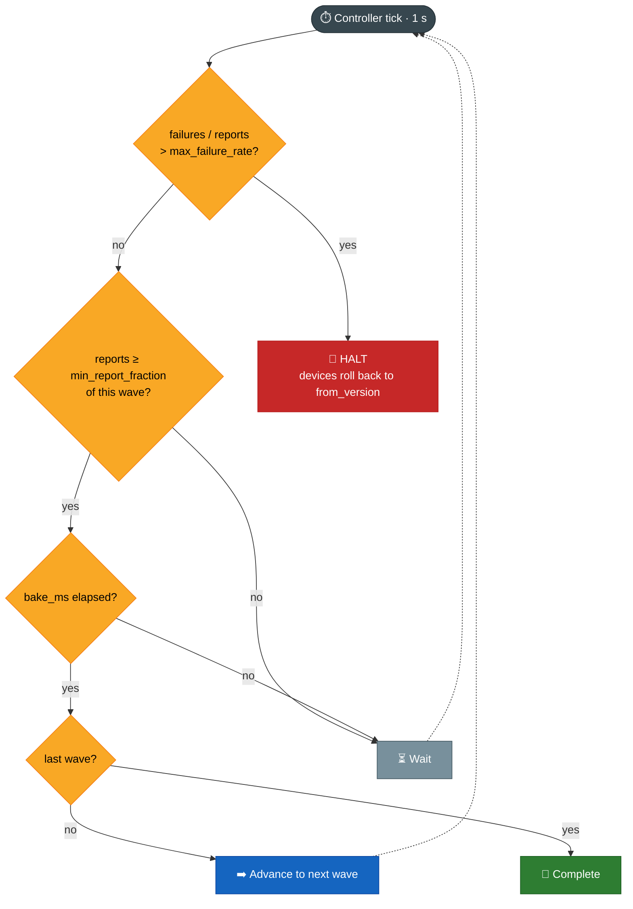
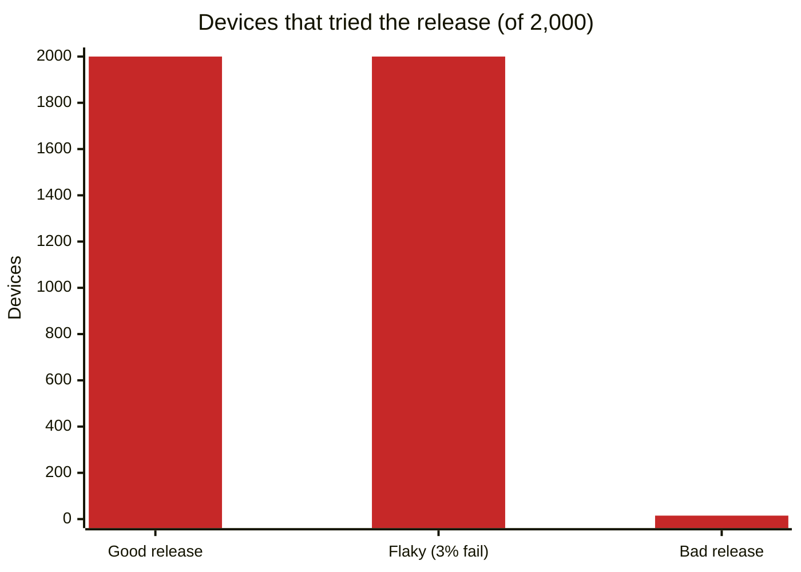
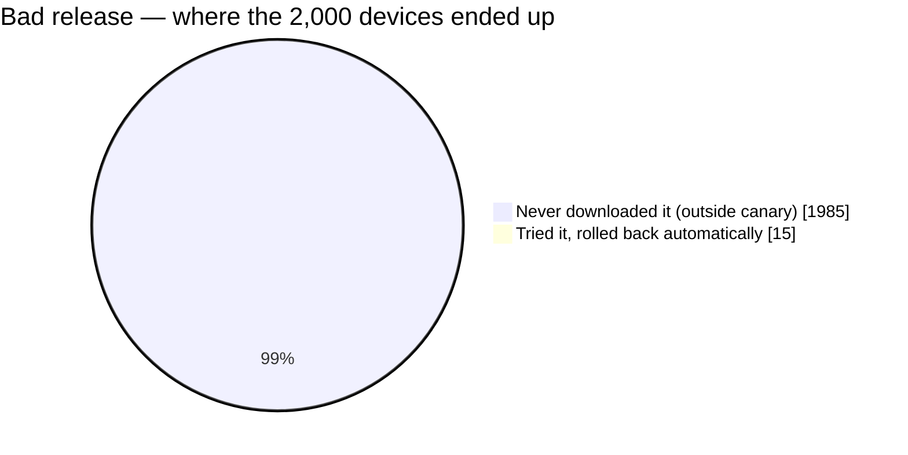
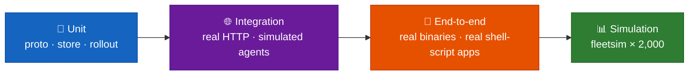

<div align="center">

# 🛰️ EDGEFLEET

### Fleet management and fail-safe OTA updates for edge devices

**Signed releases · staged canary rollouts · A/B slots with automatic rollback · crash-safe at every step**

<br/>


</div>

---

## ⚡ TL;DR

EDGEFLEET pushes software updates to a fleet of devices **without ever bricking one, and without trusting its own server**.

- 🔏 **Releases are signed offline.** The control plane only stores and serves them. Even a fully compromised server can't make a device run code that the release key didn't sign — the tests tamper with a stored artifact and every agent refuses it.
- 🐤 **Rollouts go out in waves** (e.g. 1 % → 10 % → 50 % → 100 %) behind a health gate. A broken release reached **15 of 2,000 devices** before the gate halted it, and every one of them rolled itself back.
- 🔁 **Devices update A/B style** with a boot counter, like a real bootloader. A crash at *any* step of an update — after download, after install, during trial boot, after the health check — still leaves a bootable device that converges. This is tested by crashing at every step.
- 🧱 **Written in Go with only the standard library.** Four binaries, a CRC-checked journal, real HTTP, and real Ed25519.

| Binary | Role |
|---|---|
| `fleetd` | Control plane: enrolment, heartbeats, release store, rollout controller, durable journal |
| `fleet-agent` | Runs on each device: authenticates, downloads, verifies, installs into the inactive slot, health-checks, rolls back |
| `fleetctl` | Operator CLI: keys, releases, enrolment tokens, rollouts, key sets |
| `fleetsim` | Runs thousands of real agents in one process against a real `fleetd` for benchmarks |

---

## 🏗️ Architecture



**One loop does everything.** An agent sends a signed heartbeat. `fleetd` answers with the version this device *should* run, plus the signed manifest and artifact URL. The agent downloads into its inactive slot, verifies it, trial-boots it, and reports the result exactly once — it keeps the result on disk until the server accepts it.

---

## 🔏 Trust model — the server is not trusted



| Layer | Mechanism | What it stops |
|---|---|---|
| **Release signing** | Release key stays offline. Both `fleetd` and the agent check the Ed25519 signature and the SHA-256 digest | A compromised control plane, a tampering proxy, a corrupted artifact |
| **Key rotation** *(optional, `-root-pubkey`)* | Devices pin a root key that signs a key set. A device rejects a set that is **expired**, a **rollback** to an older version, a **conflicting** set with the same version, or one that **drops a revocation** | Use of a revoked release key, replay of an old key set, quietly "un-revoking" a key |
| **Device identity** | Ed25519 key per device, enrolled with a **single-use** bootstrap token | Rogue devices, token reuse |
| **Request auth** | Every device request is signed over `method · path · timestamp · nonce · SHA-256(body)`, with a ±5 min window and nonce-reuse rejection | Replays, body tampering, path swapping |
| **Admin API** | Bearer token, compared in constant time | Unauthenticated operators, timing attacks |

> 🧪 **The key-set checks are mutation-tested.** Seven deliberate bugs (M1–M7) were injected into the verification code, and the test suite caught every one — see [`docs/evidence/`](docs/evidence/).
>
> 🕵️ **There is an adversarial test** with a proxy that re-signs a release using the revoked key, then serves the old v1 key set, then strips the key set entirely. Devices install nothing in every case.

### Signed device request



---

## 🔁 Agent update — A/B slots with a boot counter



- **The active slot is never touched** until the new version has proven healthy.
- **Every state change is durable** before the next step runs, so a power cut at any point resumes from a valid state.
- **The boot counter** catches a release that crashes the whole agent during trial: after two attempts the agent rolls back on its own, exactly like U-Boot's `bootcount`.
- **Rolling back is free** when the inactive slot still holds the old version — no re-download.
- An application is any executable that implements `app run` (the service) and `app health` (exit 0 when healthy).

---

## 🐤 Staged rollouts — the wave gate

Waves are **cumulative** percentages. A device's wave is fixed by `hash(rollout id, device id)`, so membership is deterministic, and each rollout picks a *different* canary set.



- **Halt or abort** sends every device back to `from_version`.
- **Failed devices are never retried** in the same rollout.
- **Pause / resume** are supported, and only one rollout is active at a time.

---

## 📈 Results

Measured with `fleetsim` on one 4-vCPU VM that runs the control plane **and** all 2,000 simulated devices. Devices use real HTTP on loopback, really download, hash and verify each 256 KiB artifact, and persist their A/B state. Only the health outcome is simulated. Full numbers: [`docs/benchmarks.md`](docs/benchmarks.md).

| Scenario (2,000 devices, waves 1/10/50/100 %, heartbeat 1 s) | Outcome | Time | Devices that tried it |
|---|---|---|---|
| ✅ Good release | completed — all 2,000 on 2.0 | **10.4 s** | 2,000 |
| ❌ Bad release (every trial fails) | **halted in the 1 % canary**, all rolled back | 1.4 s | **15** |
| ⚠️ Flaky release (3 % failures, 10 % limit) | completed — 1,954 on 4.0, 46 left on the old version | 10.0 s | 2,000 |

### Blast radius of a bad release





| Load metric | Value |
|---|---|
| Enrolment of 2,000 devices | 2.0 s |
| Plain heartbeat throughput | **~1,800 / s**, p99 **17 ms** |
| Heartbeat call during an active rollout (includes download + verify + trial boot) | p95 0.6 s · p99 0.9–1.4 s |
| Final heap / journal before compaction | 69 MB / 1.5 MB |

> 🔍 **Known bottleneck, understood:** each result is fsynced to the journal while holding the store lock, so heartbeats arriving at the same moment queue behind it. Group commit would remove this.

---

## 💾 Durability — the control plane survives crashes too

- **Append-only journal**, one CRC-checked record per event, **fsynced per event**.
- **Atomic snapshots** for compaction, then more events on top.
- **Torn-tail recovery:** the test cuts the journal **at every byte offset** and checks that replay yields exactly the complete events. Corruption in the *middle* of the journal is reported as an error, not silently skipped.
- **Restart mid-rollout** keeps the current wave and all results, and the rollout finishes.

---

## 🧪 Testing

`go test ./...` takes about 25 s; `go test -race ./internal/...` is clean. Logs are in [`docs/evidence/`](docs/evidence/).



| Area | Highlights |
|---|---|
| `internal/proto` | Key-set rotation lifecycle (unknown, rotated, revoked key · rollback · un-revoking · same-version conflict · expiry). Any manifest field change or wrong key is rejected. Replayed nonce, tampered body, changed path, ±5 min skew and unknown device each rejected |
| `internal/store` | Replay · compaction then more events · **journal cut at every byte** · mid-journal corruption is an error |
| `internal/rollout` | Wave sizes are proportional (20,000 devices, within 4σ) and deterministic · different rollouts pick different canaries · desired-version logic for every state · gate wait / bake / advance / halt |
| `internal/server` | Good / bad / flaky / aborted rollouts · tampered artifact refused by agents · unsigned upload refused by server · **agent crash at every update step** converges · crash loop rolled back by boot counter and reported once · resumed download fetches only the missing half · control-plane restart mid-rollout · key rotation with a tampering proxy · device clock moved 49 h ahead stops updates until a fresh key set arrives |
| `e2e` | Built binaries, apps are real shell scripts. 1.0 → 2.0 with the running process checked · a crashing 3.0 halts and every device runs a live 2.0 again · killed agent comes back on 2.0 · key rotation with `fleetctl keygen / keyset / keyset-push`. Repeated 3× |

---

## 🚀 Quick start

```bash
go build ./cmd/...
PUB=$(./fleetctl keygen -out release.key)
export FLEET_ADMIN_TOKEN=$(head -c 24 /dev/urandom | base64)

./fleetd -data fleet-data -release-pubkey "$PUB" -heartbeat-sec 5 &
./fleetctl release -key release.key -version 1.0 -file app-v1     # the version devices ship with

TOKEN=$(./fleetctl token | sed -n 's/.*"token": "\(.*\)".*/\1/p')
./fleet-agent -id dev-1 -state dev-1 -token "$TOKEN" -release-pubkey "$PUB" -exec &

./fleetctl release -key release.key -version 2.0 -file app-v2
./fleetctl rollout -version 2.0 -waves 10,50,100 -max-failure 0.1 -bake 10m
./fleetctl status <rollout-id>
```

<details>
<summary><b>🔑 Key rotation (optional)</b></summary>

```bash
ROOT=$(./fleetctl keygen -out root.key); RELA=$(./fleetctl keygen -out rel-a.key)
./fleetctl keyset -root root.key -set-version 1 -ttl 720h -keys rel-a=$RELA -out ks1.json
./fleetd -data fleet-data -root-pubkey "$ROOT" -keyset ks1.json &          # devices: fleet-agent -root-pubkey "$ROOT" ...
./fleetctl release -key rel-a.key -key-id rel-a -version 2.0 -file app-v2

RELB=$(./fleetctl keygen -out rel-b.key)                                     # rotate, revoke rel-a
./fleetctl keyset -root root.key -set-version 2 -ttl 720h -keys rel-b=$RELB -revoke rel-a -out ks2.json
./fleetctl keyset-push -file ks2.json
```

</details>

```bash
go test ./...                       # full suite, ~25 s
go test -race ./internal/...        # race detector
go run ./cmd/fleetsim -n 2000       # fleet simulation
```

---

## 📁 Repository layout

```text
EDGEFLEET/
├── cmd/
│   ├── fleetd/         # control plane
│   ├── fleet-agent/    # device agent
│   ├── fleetctl/       # operator CLI
│   └── fleetsim/       # N-device simulator
├── internal/
│   ├── proto/          # manifests, key sets, request signing
│   ├── store/          # CRC journal + snapshots
│   ├── rollout/        # waves, gate, desired-version logic
│   ├── server/         # HTTP API + integration tests
│   └── agent/          # A/B slots, boot counter, health check
├── e2e/                # tests against the real binaries
├── bench/              # report.py + results/
└── docs/               # architecture · benchmarks · testing · limitations · requirements · evidence
```

---

## 🧭 Limitations — stated honestly

| Area | Current state | Production path |
|---|---|---|
| Control plane | Single instance | Replicated store / leader election |
| A/B boot | Emulated in user space | U-Boot / GRUB integration, or RAUC / Mender |
| Update format | Full images only | Delta updates |
| Health | Generic `app health` check | App-specific SLO probes |
| Keys | Not TUF; the root key and device keys can't rotate | TUF-style roles and thresholds |
| Transport / auth | No TLS, shared admin token, key-set expiry uses the device clock | TLS / mTLS, per-operator auth, trusted time |
| Small fleets | A 1 % first wave can be empty, so the 10 % wave becomes the canary | Choose waves that give several devices in wave 0 |

Not deployed. More detail in [`docs/limitations.md`](docs/limitations.md) and [`docs/architecture.md`](docs/architecture.md).

---

<div align="center">

**Built to answer one question: _what happens when the update goes wrong?_**
Here, a bad update reaches 15 devices, and every one of them heals itself.

</div>
